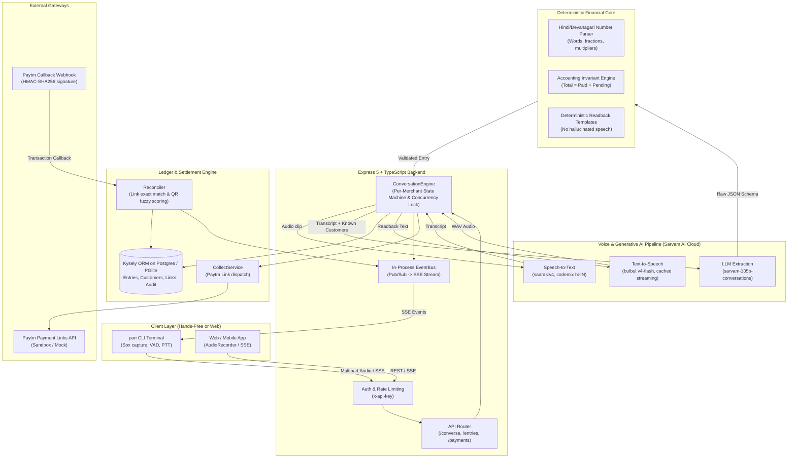
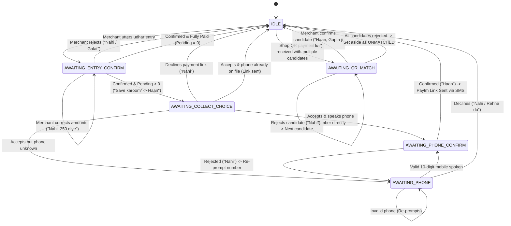
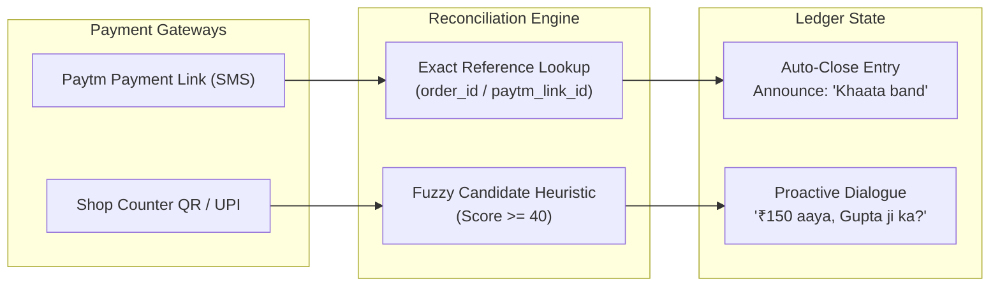

# Pari (परी)
### Voice-First Udhar Ledger & Automated Paytm Settlement for Indian Kirana Merchants

[](https://www.typescriptlang.org/)
[](https://nodejs.org/)
[](https://expressjs.com/)
[](https://sarvam.ai/)
[](https://github.com/electric-sql/pglite)
[](https://developer.paytm.com/)

---

## 1. Executive Summary

In India's retail ecosystem, hundreds of millions of daily transactions across *kirana* (mom-and-pop grocery) stores operate on **udhar** (informal shop credit). Merchants traditionally track this on paper (*bahi-khata*) or via accounting apps that demand tedious manual typing while serving a crowded counter.

**Pari** is an ambient, voice-first intelligent ledger that bridges vernacular speech and digital commerce:
1. **Speak Naturally**: The merchant speaks in code-mixed Hindi/Hinglish (e.g., *"Gupta ji ne 350 ka samaan liya, 200 UPI diya, 150 baaki"*).
2. **Deterministic Extraction & Read-Back**: Pari extracts the entities, enforces strict accounting invariants, and verifies the numbers against the spoken audio before reading back a confirmation prompt.
3. **Automated Paytm Collection**: Once confirmed, Pari dispatches an SMS payment link via Paytm for the pending amount.
4. **Intelligent Reconciliation**: The ledger automatically settles when the customer pays the link, or proactively alerts the merchant when a matching payment hits the shop's physical QR counter (*"₹150 aaya, Gupta ji ka?"*).

---

## 2. System Architecture



---

## 3. Technical Highlights

### A. The Voice & LLM Stack (Sarvam AI)
* **Speech-to-Text (`saaras:v4`)**:
  * Optimized for Indian English and Hindi code-mixed speech (`codemix` mode, `hi-IN`).
  * Injected with custom acoustic keyterms (e.g., `"Pari"`, customer names) to prevent phonetic misrecognition.
* **Large Language Model (`sarvam-105b-conversations`)**:
  * A **105-billion parameter Mixture-of-Experts (MoE)** foundation model hosted on Sarvam Cloud.
  * Configured with temperature `0.1`, JSON object schema enforcement, and optional reasoning effort control.
  * Specializes in Indian dialectal nuances, honorifics (*ji*, *bhai*, *didi*), and colloquial phrasing.
* **Text-to-Speech (`bulbul:v4-flash`)**:
  * Expressive conversational voice (`simran_enhi_customer`) operating at `1.15x` pace.
  * Features a **two-tier optimization**: in-memory LRU caching of pre-synthesized audio for recurring phrases (*"Save ho gaya"*, *"Haan ji, boliye"*) and chunked HTTP streaming for sub-500ms time-to-first-audio.

### B. Zero-Hallucination Deterministic Financial Core
Financial records cannot rely on unconstrained generative output. Pari enforces strict separation between **entity extraction** and **financial execution**:

1. **Extraction Only**: The LLM is confined to mapping raw phrases to JSON schema:
   ```json
   {
     "intent": "entry",
     "customerName": "Gupta ji",
     "totalRupees": 350,
     "paidRupees": 200,
     "pendingRupees": 150,
     "items": null
   }
   ```
2. **Deterministic Number & Phone Parser (`numbers.ts`)**:
   * Evaluates vernacular counting and fraction multipliers:
     * *sau* ($100$), *hazaar* ($1,000$), *lakh* ($100,000$).
     * *dedh* ($1.5$), *dhai* ($2.5$), *saade* ($+0.5$), *sava* ($+0.25$), *paune* ($-0.25$).
     * e.g., *"saade teen sau"* $\rightarrow 350$, *"dedh sau"* $\rightarrow 150$.
   * Parses spoken 10-digit Indian mobile numbers (Devanagari, Romanized Hindi, digit words, and repeats like *"double nine"*).
3. **Formal Accounting Invariants**:
   * Recomputes single missing fields ($Total = Paid + Pending$).
   * Formally verifies with [`checkAmountsAgainstTranscript`](backend/src/llm/numbers.ts) that every non-zero amount was explicitly uttered or directly derived. Flags unverified amounts with `needsReview: true`.
4. **Deterministic Spoken Outputs (`readback.ts`)**:
   * LLMs never construct the response audio text. Read-back lines are generated programmatically: Roman Hinglish for terminal/screen displays and Devanagari Hindi for Bulbul TTS.

---

## 4. Conversation State Machine

Every merchant interaction is handled through a per-merchant serialized session lock preventing race conditions during rapid audio inputs.



---

## 5. Dual-Channel Payment Reconciliation Engine

Pari automates cash flow reconciliation across two distinct payment modalities:



1. **Exact Link Settlement**:
   * Customer pays through the SMS link.
   * Paytm triggers `POST /api/paytm/callback` authenticated with `CHECKSUMHASH` (HMAC-SHA256).
   * Exact matching by `order_id` in database transaction; closes or decrements the entry immediately and announces: *"Gupta ji ne ₹150 de diye. Khaata band."*

2. **Heuristic QR Candidate Matching**:
   * Counter QR payments lack entry references.
   * Incoming webhook triggers candidate ranking algorithm:
     $$\text{Score} = S_{\text{amount}} + S_{\text{name}} + S_{\text{recency}}$$
     * **Amount Match ($S_{\text{amount}}$)**: $+100$ for exact pending match, $+40$ for partial payment, $+20$ for overpayment.
     * **Payer Name Similarity ($S_{\text{name}}$)**: Up to $+60$ based on Jaro-Winkler string distance against known customer record.
     * **Recency Decay ($S_{\text{recency}}$)**: Up to $+10$ decaying over a 30-day window.
   * Top candidates ($\ge 40$ score) trigger proactive ambient prompt: *"₹150 aaya, Gupta ji ka?"*.

---

## 6. Hands-Free Ambient CLI Client

The terminal client (`npm run pari`) provides an ambient voice experience with zero wake-word friction:

* **Hardware Audio Capture**: Uses `sox` (with `libsox-fmt-pulse`) for real-time capture and playback.
* **Ambient Noise Calibration**: Automatically samples ambient room noise for 1 second upon boot to dynamically configure energy thresholds.
* **Smart Voice Activity Detection (VAD)**: Streams only active speech, ignoring background shop chatter.
* **Interactive Hotkeys**:
  * <kbd>Space</kbd> : Push-to-Talk (for loud/noisy environments).
  * <kbd>E</kbd> : Instant ledger snapshot (open entries and balances).
  * <kbd>L</kbd> : Simulates customer paying the active Paytm link.
  * <kbd>Q</kbd> : Simulates counter QR payment arrival.

---

## 7. API Specification

All `/api` endpoints (except the signature-verified Paytm webhook) require the `x-api-key: <PARI_API_KEY>` header (or `?key=` query param for SSE / Audio streams).

| Method | Endpoint | Description |
| :--- | :--- | :--- |
| `POST` | `/api/converse` | Orchestrated conversational turn. Accepts multipart audio or JSON `{ text, speak }`. Returns transcript, state, reply text, base64 audio, and timing metrics. |
| `GET` | `/api/converse/state` | Retrieves the active session state for the merchant. |
| `POST` | `/api/converse/reset` | Resets active conversation to `IDLE`. |
| `GET` | `/api/events` | Server-Sent Events (SSE) stream for real-time notifications (`entry.updated`, `payment.received`, `pari.prompt`, `pari.announce`). |
| `POST` | `/api/voice/entry` | Stateless single-shot audio/text entry extraction and readback. |
| `GET` | `/api/me` | The shop's name, UPI ID and QR payload (`upi://pay?...` when `PARI_UPI_ID` is set). |
| `GET` | `/api/entries` | Lists ledger entries with optional status and customer filters, each with its latest payment link and matched payments. |
| `PATCH` | `/api/entries/:id` | Corrects an entry's amounts or customer name. |
| `POST` | `/api/entries/:id/confirm` | Confirms (`"yes"`) or rejects (`"no"`) an entry via JSON or audio. |
| `POST` | `/api/entries/:id/collect` | Dispatches a Paytm payment link to the customer's phone. |
| `GET` | `/api/customers/:id/balance` | Returns aggregate pending balance and list of open entries. |
| `GET` | `/api/payments/suggestions` | Retrieves outstanding QR payments awaiting confirmation. |
| `POST` | `/api/payments/:id/match` | Matches or rejects a suggested payment against an entry, and drops Pari's spoken question about it. |
| `GET` | `/api/tts/stream?text=` | Low-latency audio streaming of Bulbul WAV synthesis. |
| `POST` | `/api/paytm/callback` | Paytm status callback (checksum verified, public webhook). |
| `GET` | `/health` | Healthcheck reporting database status, Paytm mode, and Sarvam connectivity. |

---

## 8. Database Schema

Built using **Kysely** query builder over PostgreSQL (or embedded **PGlite** for zero-dependency local runs):

```
 merchants ──< customers ──< ledger_entries ──< payment_links
                                  │
 payments ────────────────────────┘ (via entry_id & match_status)
                                  │
 audit_log ───────────────────────┴ (immutable transition events)
```

* **`merchants`**: Store identity and SHA-256 hashed API keys.
* **`customers`**: Normalized names and verified phone numbers.
* **`ledger_entries`**: Financial state (`UNCONFIRMED`, `OPEN`, `CLOSED`, `REJECTED`), amounts in integer paise, audio transcripts, review flags.
* **`payment_links`**: Active and fulfilled Paytm link records with short URLs and order tokens.
* **`payments`**: Both `LINK` and `QR` transactions, matching status (`SUGGESTED`, `MATCHED`, `UNMATCHED`, `REJECTED`).
* **`audit_log`**: Tamper-evident transition audit trail logging actor (`merchant`, `paytm`, `system`) and payloads.

---

## 9. Getting Started

### Prerequisites
* **Node.js**: `v22.0.0` or higher.
* **Audio Tools** (for CLI audio): `sudo apt install sox libsox-fmt-pulse`.
* **Sarvam AI API Key**: Get one at [Sarvam AI Indus](https://indus.sarvam.ai).

### Installation
```bash
# Clone the repository
git clone https://github.com/mahreenaisha/pari.git
cd pari/backend

# Install dependencies
npm install

# Configure environment
cp .env.example .env
# Edit .env and insert your SARVAM_API_KEY
```

### Verify Credentials
```bash
npm run sarvam:hello
```

### Launch Pari
```bash
npm run pari
```
*Automatically initializes embedded PGlite database at `.data/pglite`, applies migrations, seeds demo customers, starts the backend, and opens the listening terminal.*

### Testing & Verification
```bash
# Run unit, integration, and E2E mock suites (90+ tests without network dependency)
npm test

# Type-check TypeScript sources
npm run typecheck

# Build for production
npm run build
```

---

## 10. Mobile App & Demo

The Expo app in [`frontend/`](frontend) (Pyari Pari) is a thin client of the conversation engine. It records the merchant, sends the clip to `POST /api/converse`, shows and speaks Pari's reply, and follows `/api/events` for payments. [`frontend/README.md`](frontend/README.md) covers development in the browser.

### Demo setup (Android phone over USB)

```bash
cd backend && npm install && cp .env.example .env   # set SARVAM_API_KEY; PARI_DEMO_SEED=true adds a few days of history
npm run dev                                          # not "npm run pari": the CLI would also listen on the laptop mic
adb reverse tcp:4000 tcp:4000                        # the phone's localhost:4000 reaches the laptop's backend
adb reverse tcp:8081 tcp:8081                        # only for a debug build served by Metro
cd ../frontend && npm install
cp .env.example .env.local                           # set EXPO_PUBLIC_DEMO_TOOLS=true
npx expo run:android                                 # or --variant release for a faster, Metro-free build
```

* Sarvam needs internet, so keep a phone hotspot as a backup. Check the Sarvam credits beforehand; the backend returns 402 when they run out.
* For a fresh start, stop the backend and delete `backend/.data/pglite`. Pari only asks for a customer's number until it has one.

### Demo script (about 3 minutes)

1. **Speak.** Tap the sky and say *"Gupta ji ne 350 ka samaan liya, 200 UPI diya, 150 baaki."*
2. **Extract and confirm.** The breakdown shows ₹350, ₹200 and ₹150, and Pari says *"Gupta ji, total ₹350, ₹200 mile, ₹150 baaki. Save karoon?"* Answer "Haan".
3. **Collect.** Pari: *"Save ho gaya. ₹150 ka payment link bhejun?"* Answer "Haan", give the number (*"98765 43210"*), and answer "Haan" to *"98765 43210. Sahi hai?"* Pari: *"Link bhej diya…"* (the mock Paytm logs the SMS).
4. **Close by link.** On the Ledger, Gupta ji shows "Link sent". Long-press the row: Pari announces *"Gupta ji ne ₹150 de diye. Khaata band."* and the row flips to "Closed by link".
5. **Reconcile a QR payment.** Say *"Verma ji ne 500 ka saamaan liya, 300 diye"*, answer "Haan", then "Abhi nahi". On the QR tab, long-press the code. Pari asks *"₹200 aaya, Verma ji ka?"* aloud and on the card. Answer "Haan" and the entry closes.
6. **Guardrail.** During a read-back, say *"Nahi, 250 diye"*: Pari corrects the entry, and nothing is saved without a "haan".
7. **Finish on the Ledger** with "To collect" and "Collected today".

In a noisy room, the buttons drive the same conversation as the voice. The Paytm sandbox is optional (see [`backend/README.md`](backend/README.md)); the demo uses simulated payments.

---

## 11. License & Credits

Built for Kirana store empowerment across India. Developed with Express, TypeScript, Sarvam AI, and Paytm.
